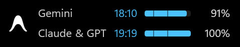
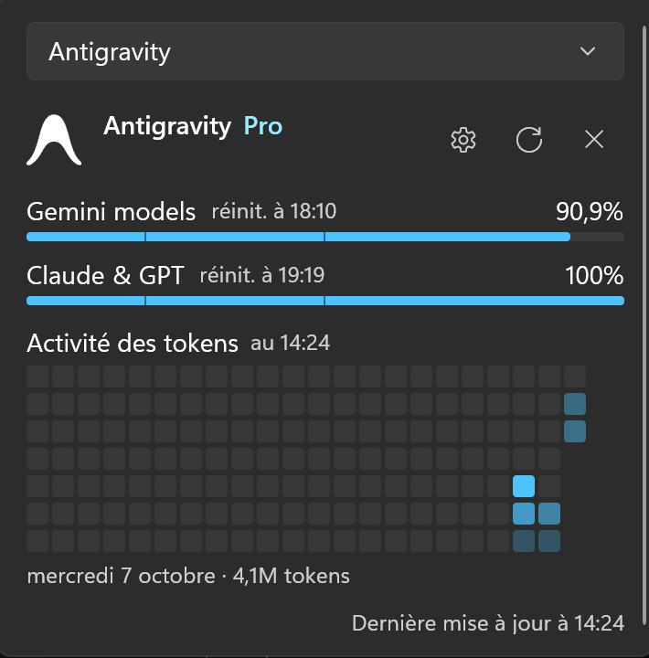
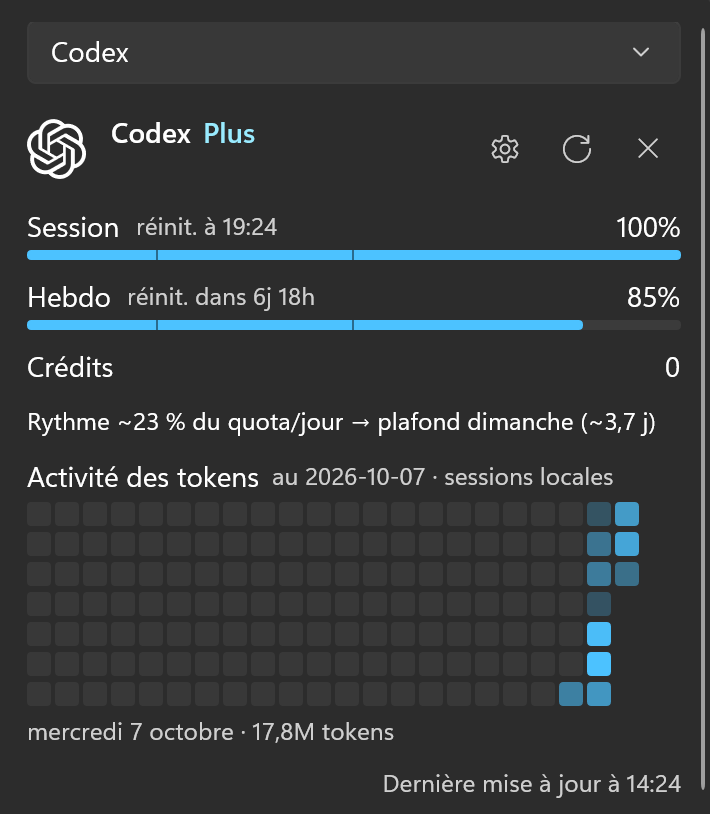
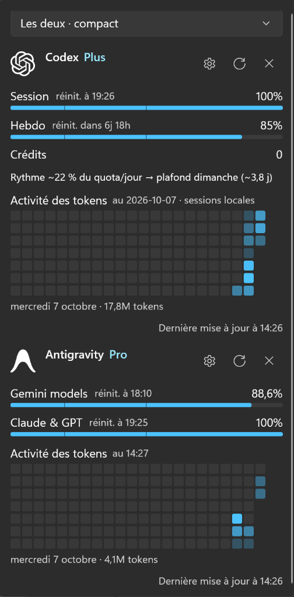

# ValthvnQuota

A lightweight, native Windows taskbar widget for real-time AI quota monitoring across **OpenAI Codex** and **Google Antigravity**.

Built with modern WinUI 3 and Desktop Acrylic, ValthvnQuota embeds directly next to your system tray to display your active quotas, countdowns, and token activity without cluttering your desktop.

> **Fork Notice**: ValthvnQuota is a fork of [CodexQuota](https://github.com/JulienMaille/CodexQuota) by Julien Maille (originally based on TaskbarQuota by zioder), extended with Google Antigravity support, pooled quota aggregation, and compact UI refinements.

---

## Screenshots

### Antigravity Monitoring
| Taskbar Widget | Detail Flyout |
| :---: | :---: |
|  |  |

### Codex (ChatGPT) Monitoring
| Taskbar Widget | Detail Flyout |
| :---: | :---: |
|  |  |

### Dual Engine (Both · Compact)
| Taskbar Widget | Detail Flyout |
| :---: | :---: |
|  |  |

---

## Key Features

- **Direct Taskbar Integration**: Injects seamlessly into the Windows taskbar next to the notification area with smooth DPI scaling and multi-monitor awareness.
- **Dual-Engine Support**:
  - **OpenAI Codex**: Live session & weekly percentages, exact reset countdowns, credit counters, and local session analytics.
  - **Google Antigravity**: Real-time quota polling directly via the local language server RPC. Grouped into two pooled quotas: **Gemini models** and **Claude & GPT**.
- **Compact Acrylic Flyout**: Click the taskbar tile to open a responsive flyout displaying detailed progress bars, plan information, exact reset times, and appearance settings. Auto-resizes to tightly fit content.
- **Token Activity Heatmap**: Visualizes up to 22 weeks of daily token activity with historical session logs.
- **Appearance Customization**: Configurable badge visibility, progress bars, colored alert thresholds (amber < 50%, red < 20%), and imminent reset timestamps.
- **Auto-Send Utility**: Optional one-shot auto-submission for Codex chat sessions as soon as the session quota resets.
- **Privacy & Local Operation**: Zero telemetry, no third-party cloud relays. Reads local session tokens directly on your machine.

---

## Installation

Download the latest standalone release or installer from the [Releases](https://github.com/valthvn/ValthvnQuota/releases) page:

1. Download `ValthvnQuota-win-x64.zip` (portable) or `ValthvnQuotaSetup-x64.exe` (installer).
2. Extract or run the setup.
3. Launch `ValthvnQuota.exe`. The widget will appear in your taskbar.

### Prerequisites

- Windows 10 (version 19041+) or Windows 11.
- For **Codex**: Logged-in session (`%USERPROFILE%\.codex\auth.json`).
- For **Antigravity**: Antigravity application running and authenticated locally.

---

## Building from Source

Requirements: .NET 9.0 SDK and Windows 10/11.

```powershell
# Clone the repository
git clone https://github.com/valthvn/ValthvnQuota.git
cd ValthvnQuota

# Build the solution
dotnet build ValthvnQuota.slnx -c Release

# Run tests (201 unit tests)
dotnet test tests/ValthvnQuota.Tests/ValthvnQuota.Tests.csproj -c Release

# Publish standalone package
dotnet publish src/ValthvnQuota.App/ValthvnQuota.App.csproj -c Release -r win-x64 --self-contained true
```

---

## How It Works

- **Codex Quotas**: Connects locally to OpenAI's usage endpoint using your session token stored in `%USERPROFILE%\.codex\auth.json`.
- **Antigravity Quotas**: Discovers the local language server process on loopback, validates memory CSRF tokens, and queries the `GetUserStatus` Connect RPC endpoint. Quotas are mapped to unified pools for Gemini and Claude/GPT models.
- **Configuration & Storage**: Settings are stored in `HKCU\Software\ValthvnQuota` and cached snapshots in `%LOCALAPPDATA%\ValthvnQuota`.

---

## Credits & License

- Based on [CodexQuota](https://github.com/JulienMaille/CodexQuota) by Julien Maille.
- Upstream lineage from [TaskbarQuota](https://github.com/zioder/TaskbarQuota) by zioder.
- Licensed under the [MIT License](LICENSE).
